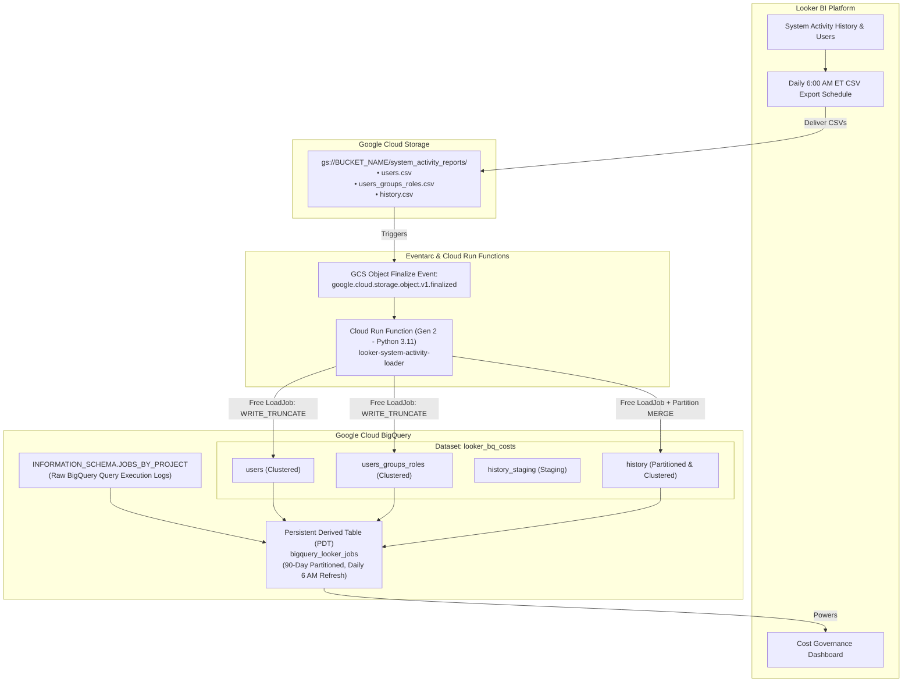

# Looker & BigQuery Cost Governance & Attribution Solution

An enterprise-grade, event-driven solution that bridges the metadata gap between **Google Cloud BigQuery execution logs** (`INFORMATION_SCHEMA.JOBS_BY_PROJECT`) and **Looker System Activity** (Users, Departments, Dashboards, Explores, and Persistent Derived Tables). 

This solution provides 100% granular cost attribution, automated $0-compute data ingestion, and a complete 4-tab interactive Looker governance dashboard.

---

## 📑 Table of Contents
1. [Solution Architecture](#-solution-architecture)
2. [Repository Structure](#-repository-structure)
3. [Prerequisites & Required IAM Permissions](#-prerequisites--required-iam-permissions)
4. [Step-by-Step Deployment Guide](#-step-by-step-deployment-guide)
   - [Step 1: Environment Configuration](#step-1-environment-configuration)
   - [Step 2: Enable Google Cloud APIs](#step-2-enable-google-cloud-apis)
   - [Step 3: Create GCS Storage Bucket & Grant IAM Roles](#step-3-create-gcs-storage-bucket--grant-iam-roles)
   - [Step 4: Initialize BigQuery Tables & DDL](#step-4-initialize-bigquery-tables--ddl)
   - [Step 5: Deploy the Cloud Run Ingestion Function](#step-5-deploy-the-cloud-run-ingestion-function)
   - [Step 6: Configure Looker System Activity Scheduled Exports](#step-6-configure-looker-system-activity-scheduled-exports)
   - [Step 7: Deploy LookML Model & Dashboards](#step-7-deploy-lookml-model--dashboards)
   - [Step 8: Initial Backfill & Validation](#step-8-initial-backfill--validation)
5. [How the Ingestion Pipeline Works](#-how-the-ingestion-pipeline-works)
6. [Data Classification & Attribution Taxonomy](#-data-classification--attribution-taxonomy)
7. [Dashboard Overview & Capabilities](#-dashboard-overview--capabilities)
8. [Monitoring & Troubleshooting](#-monitoring--troubleshooting)

---

## 🏛 Solution Architecture



### Why this architecture?
* **Zero ETL Compute Ingestion Cost**: Ingestion uses native BigQuery `LoadJob` operations from Google Cloud Storage, which do not consume BigQuery query slots or incur analysis billing.
* **Idempotent Updates**: History ingestion uses a partition-pruned `MERGE` bounded to the last 30 days, guaranteeing that duplicate or retried file uploads do not duplicate records.
* **Symmetric Aggregation Protected**: LookML measures are designed to prevent fanout when joining multi-department and multi-role user memberships.

---

## 📁 Repository Structure

```text
looker-bq-cost-governance/
├── README.md                          # Full technical design & deployment documentation
├── bigquery/
│   └── ddl/
│       ├── 01_users.sql               # Clustered dimension table for Looker users
│       ├── 02_users_groups_roles.sql  # Clustered bridge table for user group & role mappings
│       └── 03_history.sql             # Partitioned & clustered table for query execution history
├── pipeline/
│   ├── cloud_function/
│   │   ├── main.py                    # Cloud Run Function entry point & BigQuery loader
│   │   └── requirements.txt           # Python dependencies (google-cloud-bigquery, functions-framework)
│   └── deploy.sh                      # Shell deployment script with Eventarc trigger config
└── lookml/
    ├── bq_cost_attribution.model.lkml  # Model file defining datagroups, caching, and joins
    ├── views/
    │   ├── bigquery_looker_jobs.view.lkml           # Primary derived table & attribution logic
    │   └── looker_system_activity_enrichment.view.lkml # Auxiliary enrichment view
    └── dashboards/
        └── looker_bigquery_cost_governance.dashboard.lookml # 4-tab governance dashboard
```

---

## 🔐 Prerequisites & Required IAM Permissions

### 1. Deployer IAM Roles
The user or CI/CD identity executing deployment commands must possess the following roles on the Google Cloud project:

| IAM Role | Role Name | Purpose |
| :--- | :--- | :--- |
| **Cloud Functions Admin** | `roles/cloudfunctions.admin` | Deploy and configure the Gen 2 Cloud Function |
| **Cloud Run Admin** | `roles/run.admin` | Manage the underlying Cloud Run service instance |
| **Eventarc Admin** | `roles/eventarc.admin` | Create and configure GCS Eventarc triggers |
| **Storage Admin** | `roles/storage.admin` | Create bucket and configure GCS event notifications |
| **BigQuery Admin** (or Data Editor + Job User) | `roles/bigquery.admin` | Create dataset, tables, and run DDL scripts |
| **Service Account User** | `roles/iam.serviceAccountUser` | Assign runtime identity to the Cloud Function |
| **Service Usage Admin** | `roles/serviceusage.serviceUsageAdmin` | Enable required Google Cloud APIs |

### 2. Cloud Function Runtime Service Account
The Cloud Run Function uses the default Compute Engine service account (`<PROJECT_NUMBER>-compute@developer.gserviceaccount.com`) or a dedicated service account. It requires:

* `roles/bigquery.dataEditor` on dataset `looker_bq_costs`
* `roles/bigquery.jobUser` on the GCP Project
* `roles/storage.objectViewer` on the GCS Bucket
* `roles/eventarc.eventReceiver` on the GCP Project

### 3. Looker Permissions
* **Admin** or **Developer** role in Looker.
* Access to Looker **System Activity** explores (`History`, `User`, `User Group`).
* A configured Looker database connection to BigQuery with permissions to read `INFORMATION_SCHEMA.JOBS_BY_PROJECT` and create PDT scratch tables.

---

## 🚀 Step-by-Step Deployment Guide

### Step 1: Environment Configuration

Open your local terminal in the repository root directory (`looker-bq-cost-governance/`) and set your target environment variables:

```bash
# Set your GCP Project ID, Region, and GCS Bucket Name
export PROJECT_ID="YOUR_PROJECT_ID"
export REGION="us-central1"
export TRIGGER_LOCATION="us"
export BUCKET_NAME="YOUR_BUCKET_NAME"
export DATASET_ID="looker_bq_costs"

# Configure gcloud CLI context
gcloud config set project "${PROJECT_ID}"
```

---

### Step 2: Enable Google Cloud APIs

Enable all required Google Cloud APIs:

```bash
gcloud services enable \
  cloudfunctions.googleapis.com \
  run.googleapis.com \
  eventarc.googleapis.com \
  bigquery.googleapis.com \
  storage.googleapis.com \
  pubsub.googleapis.com \
  cloudresourcemanager.googleapis.com
```

---

### Step 3: Create GCS Storage Bucket & Grant IAM Roles

1. **Create the Cloud Storage Bucket** (if it does not already exist):
   ```bash
   gcloud storage buckets create "gs://${BUCKET_NAME}" \
     --project="${PROJECT_ID}" \
     --location="${TRIGGER_LOCATION}" \
     --uniform-bucket-level-access
   ```

2. **Grant GCS Pub/Sub Publisher Role**:
   Eventarc requires the GCS service agent to have permission to publish pubsub events:
   ```bash
   PROJECT_NUMBER=$(gcloud projects describe "${PROJECT_ID}" --format="value(projectNumber)")
   GCS_SERVICE_ACCOUNT="service-${PROJECT_NUMBER}@gs-project-accounts.iam.gserviceaccount.com"

   gcloud projects add-iam-policy-binding "${PROJECT_ID}" \
     --member="serviceAccount:${GCS_SERVICE_ACCOUNT}" \
     --role="roles/pubsub.publisher"
   ```

---

### Step 4: Initialize BigQuery Tables & DDL

Create the target BigQuery dataset and tables. You can run these via `bq query` or execute them in the [Google Cloud BigQuery Console](https://console.cloud.google.com/bigquery):

1. **Create Dataset**:
   ```bash
   bq --location=US mk -d "${PROJECT_ID}:${DATASET_ID}"
   ```

2. **Execute Table DDLs**:
   ```bash
   # 1. Users dimension table
   bq query --use_legacy_sql=false < bigquery/ddl/01_users.sql

   # 2. Users Groups & Roles bridge table
   bq query --use_legacy_sql=false < bigquery/ddl/02_users_groups_roles.sql

   # 3. History audit table
   bq query --use_legacy_sql=false < bigquery/ddl/03_history.sql
   ```

---

### Step 5: Deploy the Cloud Run Ingestion Function

The ingestion function is a Gen 2 Cloud Run Function in Python 3.11.

#### What the Cloud Function Does:
1. **Listens to GCS**: Triggered automatically via Eventarc when any file is uploaded to `gs://${BUCKET_NAME}/system_activity_reports/`.
2. **Filters & Routes**:
   * `*users.csv*`: Executes an atomic `WRITE_TRUNCATE` load job into `looker_bq_costs.users`.
   * `*users_groups_roles.csv*`: Executes an atomic `WRITE_TRUNCATE` load job into `looker_bq_costs.users_groups_roles`.
   * `*history.csv*`: Loads records into staging (`history_staging`), then executes an idempotent partition-pruned `MERGE` into `looker_bq_costs.history` matching on `history_id`.
3. **$0 Slot Compute**: Uses native BigQuery load jobs (free of charge).

#### Deploy via Script:
From the repository root:
```bash
chmod +x pipeline/deploy.sh
./pipeline/deploy.sh
```

#### Or Deploy Directly with `gcloud`:
```bash
gcloud functions deploy looker-system-activity-loader \
  --gen2 \
  --runtime=python311 \
  --region="${REGION}" \
  --trigger-location="${TRIGGER_LOCATION}" \
  --source=./pipeline/cloud_function \
  --entry-point=gcs_to_bigquery_loader \
  --trigger-event-filters="type=google.cloud.storage.object.v1.finalized" \
  --trigger-event-filters="bucket=${BUCKET_NAME}" \
  --set-env-vars="GCP_PROJECT=${PROJECT_ID},BQ_DATASET=${DATASET_ID}" \
  --memory=512Mi \
  --timeout=300s \
  --project="${PROJECT_ID}"
```

---

### Step 6: Configure Looker System Activity Scheduled Exports

In your Looker web interface, set up daily automated exports from Looker's System Activity explores to GCS.

#### Report 1: `users.csv`
1. Navigate to **Explore > System Activity > User**.
2. Select fields:
   * `User ID` (`user.id`)
   * `Name` (`user.name`)
   * `Email` (`user.email`)
3. Click the gear icon $\rightarrow$ **Save and Schedule**.
4. **Destination**: Google Cloud Storage (`gs://<BUCKET_NAME>/system_activity_reports/users.csv`).
5. **Format**: CSV (no formatting).
6. **Trigger**: Daily at `5:30 AM ET` (or 30 mins before PDT rebuild).

#### Report 2: `users_groups_roles.csv`
1. Navigate to **Explore > System Activity > User**.
2. Select fields:
   * `User ID` (`user.id`)
   * `User Name` (`user.name`)
   * `Role ID` (`role.id`)
   * `Role Name` (`role.name`)
   * `Group ID` (`group.id`)
   * `Group Name` (`group.name`)
3. Save and Schedule to `gs://<BUCKET_NAME>/system_activity_reports/users_groups_roles.csv` at `5:30 AM ET`.

#### Report 3: `history.csv`
1. Navigate to **Explore > System Activity > History**.
2. Select fields:
   * `History ID` (`history.id`)
   * `Created Time` (`history.created_time`)
   * `Query ID` (`query.id`)
   * `Dashboard ID` (`history.dashboard_id`)
   * `Dashboard Title` (`history.dashboard_title`)
   * `Explore` (`query.view`)
   * `Model` (`query.model`)
   * `User ID` (`history.user_id`)
   * `History Slug` (`history.slug`)
   * `Source` (`history.source`)
   * `API Client Name` (`query_api_client_context.name`)
   * `Agent Name` (`agent.name`)
   * `CA Agent ID` (`query_api_client_context.ca_agent_id`)
   * `CA Conversation ID` (`query_api_client_context.ca_conversation_id`)
3. Add filter: `History Created Date` = `in the past 3 days` (provides overlap for resilience).
4. Save and Schedule to `gs://<BUCKET_NAME>/system_activity_reports/history.csv` at `5:30 AM ET`.


---

### Step 7: Deploy LookML Model & Dashboards

1. Copy the files in `lookml/` into your Looker project (e.g. `bq_cost_attribution`):
   * `lookml/bq_cost_attribution.model.lkml`
   * `lookml/views/bigquery_looker_jobs.view.lkml`
   * `lookml/views/looker_system_activity_enrichment.view.lkml`
   * `lookml/dashboards/looker_bigquery_cost_governance.dashboard.lookml`
2. Verify that the `connection:` parameter in `bq_cost_attribution.model.lkml` matches your BigQuery connection name.
3. Validate LookML and deploy to Production.

---

### Step 8: Initial Backfill & Validation

To test the end-to-end pipeline immediately without waiting for the morning schedule:

1. Export manual CSVs from Looker or upload sample CSVs to `gs://${BUCKET_NAME}/system_activity_reports/`.
2. Check Cloud Function execution logs:
   ```bash
   gcloud beta run services logs tail looker-system-activity-loader --project="${PROJECT_ID}" --region="${REGION}"
   ```
3. Query BigQuery to verify table population:
   ```sql
   SELECT count(*) FROM `looker_bq_costs.history`;
   SELECT count(*) FROM `looker_bq_costs.users`;
   ```
4. In Looker, navigate to the **Looker & BigQuery Cost Governance** dashboard and verify all tiles populate with live data.

---

## 🔍 Data Classification & Attribution Taxonomy

The Persistent Derived Table (`bigquery_looker_jobs`) implements a robust 5-tier classification hierarchy:

### 1. `query_source`
Identifies the exact mechanism triggering the BigQuery execution:
* `conversational_analytics`: Natural language queries generated by Looker Conversational Analytics / Gemini.
* `pdt_build`: Looker background Persistent Derived Table builds and regenerator rebuilds.
* `dashboard`: Interactive tile queries executed by users viewing dashboards.
* `look`: Saved report queries from Looker Looks.
* `explore_adhoc`: Interactive ad-hoc queries executed by users exploring data models.
* `scheduled_task`: Background scheduled data deliveries and rendering jobs.
* `alert`: Automated conditional alert threshold evaluations.
* `sql_runner`: Ad-hoc SQL queries executed in Looker SQL Runner.
* `api`: Programmatic queries executed via Looker SDK or REST API.
* `direct_bigquery`: Queries executed directly in BigQuery without Looker UI context comments (including connection heartbeats and external ETL).

### 2. `query_origin_type`
High-level classification for executive reporting:
* `Conversational Analytics`
* `Looker PDT Build`
* `Looker Dashboard`
* `Looker Look`
* `Looker Explore Query`
* `Looker SQL Runner`
* `Looker Platform Maintenance`
* `External Data Pipeline`
* `Direct BigQuery (Human User)`

### 3. `model_name` & `explore_name` Resolution Hierarchy
1. **Conversational Analytics Match**: Directly attributes to Conversational Analytics Agent / query context.
2. **System Activity Match**: Directly pulls the model/explore from `looker_bq_costs.history` matched by `history_slug`.
3. **Context Comment / Label JSON**: Extracts `explore` and `model` tokens injected into the query headers.
4. **PDT Regex**: Extracts model and view names from PDT build statements (`-- Building persistent derived table <model>::<view>`).
5. **Ad-hoc Explore Fallback**: Distinguishes genuine user ad-hoc sessions (`Looker Ad-hoc Query` / `Looker Ad-hoc Explore`) from background platform engine connection checks (`Connection Heartbeat & Metadata` / `Looker Platform System`).
6. **External Pipeline Fallback**: Identifies external service accounts (`Pipeline: <service_account_prefix>`).

### 4. `cost_center` Allocation
* `Conversational Analytics`: Natural language queries driven by Conversational Analytics agents and Gemini in Looker.
* `Shared Infrastructure / Looker PDTs`: All PDT build operations.
* `Business Teams`: Queries initiated by named business users (dashboards, looks, explores).
* `Shared / Looker System`: System scheduled queries and platform maintenance tasks.
* `Non-Looker / Direct BigQuery`: Queries run outside Looker.


### 5. BigQuery Billing Logic
* **10 MB Minimum**: BigQuery enforces a minimum 10 MB charge for queries scanning between 1 byte and 10 MB. `effective_bytes_billed` applies this minimum to non-cached queries.
* **Cache Hits**: Queries served from cache have `cache_hit = true` and `effective_bytes_billed = 0` ($0.00 cost).
* **On-Demand Pricing**: Standard pricing defaults to **$6.25 / TB** with an adjustable parameter in the dashboard.
* **Free Tier Credit**: Calculates gross cost and net cost factoring in Google Cloud's 1 TB/month free analysis tier ($6.25 monthly credit).

---

## 📊 Dashboard Overview & Capabilities

The dashboard provides 4 specialized analytics tabs:

1. **Executive Overview & Spend Velocity**:
   * High-level KPI cards (Total Spend, Net Cost, Total Queries, Active Users, Cache Hit Rate).
   * Daily Spend Velocity & Volume dual-axis trend.
   * Spend by Origin Category and Top 5 Most Expensive Assets.
2. **User & Department Chargeback**:
   * Department and User Group cost breakdowns.
   * Top 10 Most Expensive Querying Users with drilldowns to individual SQL queries.
   * Direct vs Looker cost split.
3. **Content & Dashboard Optimization**:
   * Most expensive dashboards, looks, and explores.
   * Model and Explore cost distribution.
   * Cache efficiency and query optimization opportunities.
4. **PDT & Shared Infrastructure Monitoring**:
   * PDT build spend and frequency by model and table.
   * Long-running PDT build tracking and compute slot consumption.
   * Scratch schema storage analysis.

---

## 🛠 Monitoring & Troubleshooting

### Viewing Function Logs
```bash
gcloud beta run services logs tail looker-system-activity-loader \
  --project="YOUR_PROJECT_ID" \
  --region="us-central1"
```

### Manual Trigger / Test Ingestion
Upload a test CSV directly to GCS:
```bash
gcloud storage cp test_history.csv gs://YOUR_BUCKET_NAME/system_activity_reports/history.csv
```

### Inspecting BigQuery Staging & Tables
```sql
SELECT 
  _PARTITIONDATE AS partition_date,
  count(*) AS row_count
FROM `looker_bq_costs.history`
GROUP BY 1
ORDER BY 1 DESC;
```
