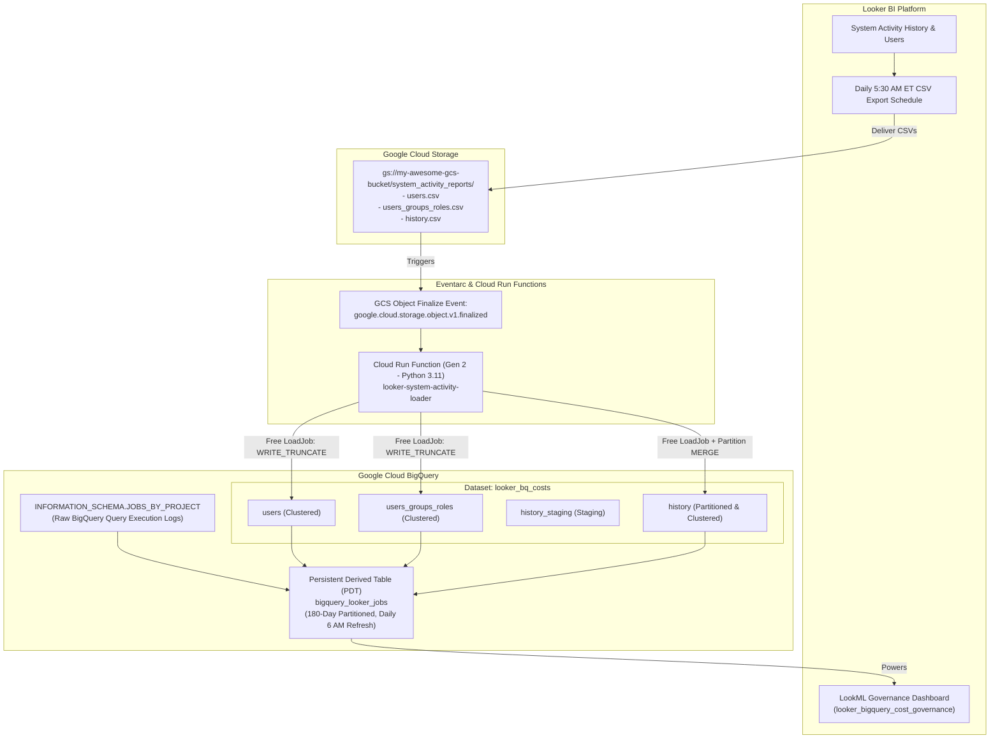

# Looker & BigQuery Cost Governance & Attribution Solution

An enterprise-grade, event-driven solution that bridges the metadata gap between **Google Cloud BigQuery execution logs** (`INFORMATION_SCHEMA.JOBS_BY_PROJECT`) and **Looker System Activity** (Users, Groups, Roles, Dashboards, Looks, Explores, and Persistent Derived Tables).

This solution delivers 100% granular cost attribution, automated zero-compute data ingestion, and a complete 4-tab interactive **LookML Dashboard** (`looker_bigquery_cost_governance.dashboard.lookml`) that is source-controlled and deployed directly via LookML.

---

## Table of Contents
1. [Solution Overview & LookML Dashboard](#solution-overview--lookml-dashboard)
2. [Solution Architecture](#solution-architecture)
3. [Repository Structure](#repository-structure)
4. [Prerequisites & Required IAM Permissions](#prerequisites--required-iam-permissions)
5. [Configuration Placeholders & Manifest Reference](#configuration-placeholders--manifest-reference)
6. [PDT Build Timing & Modification Guide](#pdt-build-timing--modification-guide)
7. [Step-by-Step Deployment Guide](#step-by-step-deployment-guide)
   - [Step 1: Clone the GitHub Repository](#step-1-clone-the-github-repository)
   - [Step 2: Environment Configuration](#step-2-environment-configuration)
   - [Step 3: Enable Google Cloud APIs](#step-3-enable-google-cloud-apis)
   - [Step 4: Create GCS Storage Bucket & Grant IAM Roles](#step-4-create-gcs-storage-bucket--grant-iam-roles)
   - [Step 5: Initialize BigQuery Tables & DDL](#step-5-initialize-bigquery-tables--ddl)
   - [Step 6: Deploy the Cloud Run Ingestion Function](#step-6-deploy-the-cloud-run-ingestion-function)
   - [Step 7: Configure Looker System Activity Scheduled Exports](#step-7-configure-looker-system-activity-scheduled-exports)
   - [Step 8: Create the LookML Project & Configure Manifest](#step-8-create-the-lookml-project--configure-manifest)
   - [Step 9: Initial Backfill & Validation](#step-9-initial-backfill--validation)
8. [Data Classification & Attribution Taxonomy](#data-classification--attribution-taxonomy)
9. [Dashboard Tabs & Capabilities](#dashboard-tabs--capabilities)
10. [Monitoring & Troubleshooting](#monitoring--troubleshooting)

---

## Solution Overview & LookML Dashboard

Unlike user-defined dashboards (UDDs) that reside in personal or shared folders, this solution deploys a governed **LookML Dashboard** defined in version-controlled `.dashboard.lookml` files.

### Key Benefits of a LookML Dashboard
* **Source-Controlled & Versioned**: The entire dashboard definition, filters, layouts, and visualization parameters live in Git alongside your data models.
* **Instant Multi-Environment Deployment**: Automatically deployable across development, staging, and production Looker instances without manual UI rebuilding or broken dashboard references.
* **Governed Performance**: Tightly coupled with LookML Datagroups and Persistent Derived Tables (PDTs), ensuring sub-second tile load times.

---

## Solution Architecture



### Why This Architecture?
* **Zero ETL Compute Ingestion Cost**: Ingestion uses native BigQuery `LoadJob` operations from Cloud Storage, which do not consume query slots or incur analysis billing.
* **Idempotent Updates**: History ingestion uses a partition-pruned `MERGE` bounded to the last 30 days, preventing duplicate records if files are re-sent.
* **Symmetric Aggregation Protected**: LookML measures prevent fanout when joining multi-department and multi-role user memberships.

---

## Repository Structure

```text
looker-bq-cost-governance/
├── README.md                          # Full technical design & deployment documentation
├── bigquery/
│   └── ddl/
│       ├── 01_users.sql               # Clustered dimension table for Looker users
│       ├── 02_users_groups_roles.sql  # Clustered bridge table for user group & role mappings
│       └── 03_history.sql             # Partitioned & clustered table for query execution history
├── pipeline/
│   ├── cloud_function/
│   │   ├── main.py                    # Cloud Run Function entry point & BigQuery loader
│   │   └── requirements.txt           # Python dependencies (google-cloud-bigquery, functions-framework)
│   └── deploy.sh                      # Shell deployment script with Eventarc trigger config
└── lookml/
    ├── manifest.lkml                  # Central project configuration constants (ONE-STOP LookML setup)
    ├── bq_cost_attribution.model.lkml  # Model file defining datagroups, caching, and joins
    ├── views/
    │   ├── bigquery_looker_jobs.view.lkml              # Primary derived table & attribution logic
    │   ├── looker_history.view.lkml                    # Looker System Activity history view
    │   ├── looker_users_groups_roles.view.lkml         # User groups and roles bridge view
    │   └── looker_system_activity_enrichment.view.lkml # Auxiliary enrichment view
    └── dashboards/
        └── looker_bigquery_cost_governance.dashboard.lookml # 4-tab LookML governance dashboard
```

---

## Prerequisites & Required IAM Permissions

### 1. Deployer IAM Roles
The identity executing deployment commands must possess the following roles on the Google Cloud project:

| IAM Role | Role Name | Purpose |
| :--- | :--- | :--- |
| **Cloud Functions Admin** | `roles/cloudfunctions.admin` | Deploy and configure the Gen 2 Cloud Function |
| **Cloud Run Admin** | `roles/run.admin` | Manage the underlying Cloud Run service instance |
| **Eventarc Admin** | `roles/eventarc.admin` | Create and configure GCS Eventarc triggers |
| **Storage Admin** | `roles/storage.admin` | Create bucket and configure GCS event notifications |
| **BigQuery Admin** (or Data Editor + Job User) | `roles/bigquery.admin` | Create dataset, tables, and run DDL scripts |
| **Service Account User** | `roles/iam.serviceAccountUser` | Assign runtime identity to the Cloud Function |
| **Service Usage Admin** | `roles/serviceusage.serviceUsageAdmin` | Enable required Google Cloud APIs |

### 2. Cloud Function Runtime Service Account
The Cloud Run Function uses the default Compute Engine service account (`<PROJECT_NUMBER>-compute@developer.gserviceaccount.com`) or a dedicated service account. It requires:

* `roles/bigquery.dataEditor` on dataset `looker_bq_costs`
* `roles/bigquery.jobUser` on the GCP Project
* `roles/storage.objectViewer` on the GCS Bucket
* `roles/eventarc.eventReceiver` on the GCP Project

### 3. Looker Permissions
* **Admin** or **Developer** role in Looker.
* Access to Looker **System Activity** explores (`History`, `User`).
* A configured Looker database connection to BigQuery with permissions to read `INFORMATION_SCHEMA.JOBS_BY_PROJECT` and create PDT scratch tables.

---

## Configuration Placeholders & Manifest Reference

To make deployment seamless, all placeholder values are isolated into clear, obvious configuration points:

### 1. One-Stop LookML Configuration (`lookml/manifest.lkml`)
In LookML, all project dependencies are managed centrally through **LookML Constants** in `lookml/manifest.lkml`. You only need to update these 4 values, and all models, views, and dashboards update automatically:

```lookml
project_name: "bq_cost_attribution"

constant: CONNECTION_NAME {
  value: "my_awesome_bq_connection"       # Your Looker BigQuery database connection name
  export: override_optional
}

constant: GCP_PROJECT_ID {
  value: "my-awesome-gcp-project"          # Your Google Cloud Project ID
  export: override_optional
}

constant: BQ_REGION {
  value: "region-us"                       # BigQuery Region (region-us, region-eu, region-us-central1)
  export: override_optional
}

constant: BQ_DATASET_NAME {
  value: "looker_bq_costs"                 # Target BigQuery dataset for ingested tables
  export: override_optional
}
```

### 2. Comprehensive Placeholders Table

| Placeholder Variable | Example / Default Value | Files Where It Appears | How to Update |
| :--- | :--- | :--- | :--- |
| `GCP_PROJECT_ID` | `my-awesome-gcp-project` | `lookml/manifest.lkml`<br>`pipeline/deploy.sh`<br>`bigquery/ddl/*.sql` | Update `constant: GCP_PROJECT_ID` in `manifest.lkml`, pass to `pipeline/deploy.sh`, or edit DDL scripts. |
| `BQ_REGION` | `region-us` | `lookml/manifest.lkml`<br>`pipeline/deploy.sh` | Update `constant: BQ_REGION` in `manifest.lkml` (`region-us`, `region-eu`, etc.). |
| `BQ_DATASET_NAME` | `looker_bq_costs` | `lookml/manifest.lkml`<br>`pipeline/deploy.sh`<br>`bigquery/ddl/*.sql` | Update `constant: BQ_DATASET_NAME` in `manifest.lkml` and DDL scripts. |
| `CONNECTION_NAME` | `my_awesome_bq_connection` | `lookml/manifest.lkml` | Set to your Looker connection name (Admin > Database > Connections). |
| `BUCKET_NAME` | `my-awesome-gcs-bucket` | `pipeline/deploy.sh`<br>Looker Schedule UI | Target GCS bucket for scheduled System Activity CSV exports. |

---

## PDT Build Timing & Modification Guide

### Default Schedule
The Persistent Derived Table (`bigquery_looker_jobs`) is configured to rebuild **once every 24 hours at 6:00 AM ET (America/New_York)**. 

### Why 6:00 AM ET?
Looker System Activity exports are scheduled to deliver CSVs to GCS at **5:30 AM ET**. The Cloud Function ingests these files into BigQuery within seconds. The 6:00 AM ET datagroup trigger ensures that the PDT rebuilds against the freshest Looker history and user metadata every morning before business hours.

### Where to Modify the Schedule in Code

1. **Model Datagroup Definition** (`lookml/bq_cost_attribution.model.lkml`):
   ```lookml
   datagroup: bq_cost_attribution_daily_6am {
     max_cache_age: "24 hours"
     sql_trigger: SELECT CAST(TIMESTAMP_TRUNC(TIMESTAMP_SUB(CURRENT_TIMESTAMP(), INTERVAL 6 HOUR), DAY, 'America/New_York') AS STRING) ;;
     description: "Triggers PDT rebuild every 24 hours at 6:00 AM ET (America/New_York)"
   }
   ```
   * **To change the time**: Adjust the `INTERVAL <N> HOUR` offset or replace the timezone string (e.g., `'UTC'`, `'America/Los_Angeles'`).
   * **To use an interval-based trigger**: Replace `sql_trigger` with `interval_trigger: "12 hours"` or `"4 hours"`.

2. **PDT Binding** (`lookml/views/bigquery_looker_jobs.view.lkml`):
   ```lookml
   view: bigquery_looker_jobs {
     derived_table: {
       datagroup_trigger: bq_cost_attribution_daily_6am
       partition_keys: ["creation_date"]
       cluster_keys: ["history_slug", "job_id", "looker_user_name"]
       sql: ...
   ```
   * If you rename the datagroup in the model file, update `datagroup_trigger:` here to match the new name.

---

## Step-by-Step Deployment Guide

### Step 1: Clone the GitHub Repository

Open your local terminal and clone the repository:

```bash
# Clone the repository
git clone https://github.com/Ace-Kinkaid/looker-bigquery-costs-public.git looker-bq-cost-governance

# Navigate into the project directory
cd looker-bq-cost-governance
```

---

### Step 2: Environment Configuration

Set your deployment environment variables in your terminal session:

```bash
# Set your GCP Project ID, Region, and GCS Bucket Name
export PROJECT_ID="my-awesome-gcp-project"
export REGION="us-central1"
export TRIGGER_LOCATION="us"
export BUCKET_NAME="my-awesome-gcs-bucket"
export DATASET_ID="looker_bq_costs"

# Configure gcloud CLI context
gcloud config set project "${PROJECT_ID}"
```

---

### Step 3: Enable Google Cloud APIs

Enable the necessary APIs:

```bash
gcloud services enable \
  cloudfunctions.googleapis.com \
  run.googleapis.com \
  eventarc.googleapis.com \
  bigquery.googleapis.com \
  storage.googleapis.com \
  pubsub.googleapis.com \
  cloudresourcemanager.googleapis.com
```

---

### Step 4: Create GCS Storage Bucket & Grant IAM Roles

1. **Create the Cloud Storage Bucket** (if not already existing):
   ```bash
   gcloud storage buckets create "gs://${BUCKET_NAME}" \
     --project="${PROJECT_ID}" \
     --location="${TRIGGER_LOCATION}" \
     --uniform-bucket-level-access
   ```

2. **Grant GCS Pub/Sub Publisher Role**:
   ```bash
   PROJECT_NUMBER=$(gcloud projects describe "${PROJECT_ID}" --format="value(projectNumber)")
   GCS_SERVICE_ACCOUNT="service-${PROJECT_NUMBER}@gs-project-accounts.iam.gserviceaccount.com"

   gcloud projects add-iam-policy-binding "${PROJECT_ID}" \
     --member="serviceAccount:${GCS_SERVICE_ACCOUNT}" \
     --role="roles/pubsub.publisher"
   ```

---

### Step 5: Initialize BigQuery Tables & DDL

Create the target BigQuery dataset and audit tables:

1. **Create Dataset**:
   ```bash
   bq --location=US mk -d "${PROJECT_ID}:${DATASET_ID}"
   ```

2. **Execute Table DDLs**:
   Open the DDL scripts in `bigquery/ddl/` and replace `my-awesome-gcp-project.looker_bq_costs` with your actual `<PROJECT_ID>.<DATASET_ID>`, or run them via `sed`:
   ```bash
   # 1. Users dimension table
   sed "s/my-awesome-gcp-project.looker_bq_costs/${PROJECT_ID}.${DATASET_ID}/g" bigquery/ddl/01_users.sql | bq query --use_legacy_sql=false

   # 2. Users Groups & Roles bridge table
   sed "s/my-awesome-gcp-project.looker_bq_costs/${PROJECT_ID}.${DATASET_ID}/g" bigquery/ddl/02_users_groups_roles.sql | bq query --use_legacy_sql=false

   # 3. History audit table
   sed "s/my-awesome-gcp-project.looker_bq_costs/${PROJECT_ID}.${DATASET_ID}/g" bigquery/ddl/03_history.sql | bq query --use_legacy_sql=false
   ```

---

### Step 6: Deploy the Cloud Run Ingestion Function

Deploy the Gen 2 Cloud Run Function (Python 3.11):

```bash
# Using the deployment script:
./pipeline/deploy.sh "${PROJECT_ID}" "${BUCKET_NAME}" "${REGION}" "${TRIGGER_LOCATION}"

# Or deploy directly with gcloud:
gcloud functions deploy looker-system-activity-loader \
  --gen2 \
  --runtime=python311 \
  --region="${REGION}" \
  --trigger-location="${TRIGGER_LOCATION}" \
  --source=./pipeline/cloud_function \
  --entry-point=gcs_to_bigquery_loader \
  --trigger-event-filters="type=google.cloud.storage.object.v1.finalized" \
  --trigger-event-filters="bucket=${BUCKET_NAME}" \
  --set-env-vars="GCP_PROJECT=${PROJECT_ID},BQ_DATASET=${DATASET_ID}" \
  --memory=512Mi \
  --timeout=300s \
  --project="${PROJECT_ID}"
```

---

### Step 7: Configure Looker System Activity Scheduled Exports

In your Looker web interface, set up daily automated exports from System Activity explores to GCS.

#### Report 1: `users.csv`
1. Navigate to **Explore > System Activity > User**.
2. Select fields:
   * `User ID` (`user.id`)
   * `Name` (`user.name`)
   * `Email` (`user.email`)
3. Click the gear icon -> **Save and Schedule**.
4. **Destination**: Google Cloud Storage (`gs://my-awesome-gcs-bucket/system_activity_reports/users.csv`).
5. **Format**: CSV (no formatting).
6. **Trigger**: Daily at `5:30 AM ET`.

#### Report 2: `users_groups_roles.csv`
1. Navigate to **Explore > System Activity > User**.
2. Select fields:
   * `User ID` (`user.id`)
   * `User Name` (`user.name`)
   * `Role ID` (`role.id`)
   * `Role Name` (`role.name`)
   * `Group ID` (`group.id`)
   * `Group Name` (`group.name`)
3. Save and Schedule to `gs://my-awesome-gcs-bucket/system_activity_reports/users_groups_roles.csv` at `5:30 AM ET`.

#### Report 3: `history.csv`
1. Navigate to **Explore > System Activity > History**.
2. Select fields:
   * `History ID` (`history.id`)
   * `Created Time` (`history.created_time`)
   * `Query ID` (`query.id`)
   * `Dashboard ID` (`history.dashboard_id`)
   * `Dashboard Title` (`history.dashboard_title`)
   * `Explore` (`query.view`)
   * `Model` (`query.model`)
   * `User ID` (`history.user_id`)
   * `History Slug` (`history.slug`)
   * `Source` (`history.source`)
   * `API Client Name` (`query_api_client_context.name`)
   * `Agent Name` (`agent.name`)
   * `CA Agent ID` (`query_api_client_context.ca_agent_id`)
   * `CA Conversation ID` (`query_api_client_context.ca_conversation_id`)
3. Add filter: `History Created Date` = `in the past 3 days` (provides overlap for resilience).
4. Save and Schedule to `gs://my-awesome-gcs-bucket/system_activity_reports/history.csv` at `5:30 AM ET`.

---

### Step 8: Create the LookML Project & Configure Manifest

Follow these steps to create and configure the LookML project in Looker:

1. **Enable Development Mode**:
   * In Looker, toggle the **Development Mode** switch on in the bottom-left navigation bar.

2. **Create New LookML Project**:
   * Navigate to **Develop** > **Projects**.
   * Click **New LookML Project**.
   * **Project Name**: Enter `bq_cost_attribution`.
   * **Starting Point**: Select **Blank Project** (or configure Git connection to your cloned repo).
   * Click **Create Project**.

3. **Create Folder Structure & Add Files**:
   * Create two folders: `/views/` and `/dashboards/`.
   * Copy the files from this repository into your project:
     * Root: `manifest.lkml`, `bq_cost_attribution.model.lkml`
     * `/views/`:
       * `bigquery_looker_jobs.view.lkml`
       * `looker_history.view.lkml`
       * `looker_users_groups_roles.view.lkml`
       * `looker_system_activity_enrichment.view.lkml`
     * `/dashboards/`:
       * `looker_bigquery_cost_governance.dashboard.lookml`

4. **Update `manifest.lkml`**:
   * Open `manifest.lkml` and update the constants:
     ```lookml
     constant: CONNECTION_NAME {
       value: "your_bigquery_connection_name"
     }
     constant: GCP_PROJECT_ID {
       value: "your-actual-gcp-project-id"
     }
     constant: BQ_REGION {
       value: "region-us"
     }
     constant: BQ_DATASET_NAME {
       value: "looker_bq_costs"
     }
     ```

5. **Validate & Deploy to Production**:
   * Click **Validate LookML** in the top-right corner (verify 0 errors).
   * Click **Commit Changes & Push**.
   * Click **Deploy to Production**.

6. **Open the LookML Dashboard**:
   * Navigate to **Browse** > **LookML Dashboards**.
   * Click **Looker & BigQuery Cost Governance** (or navigate directly to `/dashboards/bq_cost_attribution::looker_bigquery_cost_governance`).

---

### Step 9: Initial Backfill & Validation

To test the end-to-end pipeline immediately without waiting for the scheduled delivery:

1. Export manual CSVs from Looker or upload sample CSVs to `gs://${BUCKET_NAME}/system_activity_reports/`.
2. Check Cloud Function execution logs:
   ```bash
   gcloud beta run services logs tail looker-system-activity-loader --project="${PROJECT_ID}" --region="${REGION}"
   ```
3. Query BigQuery to verify table population:
   ```sql
   SELECT count(*) FROM `looker_bq_costs.history`;
   SELECT count(*) FROM `looker_bq_costs.users`;
   ```
4. In Looker, refresh the **Looker & BigQuery Cost Governance** dashboard and verify all tiles populate with live data.

---

## Data Classification & Attribution Taxonomy

The Persistent Derived Table (`bigquery_looker_jobs`) implements a 5-tier classification hierarchy:

### 1. `query_source`
Identifies the exact mechanism triggering the BigQuery execution:
* `conversational_analytics`: Natural language queries generated by Looker Conversational Analytics / Gemini.
* `pdt_build`: Looker background Persistent Derived Table builds and regenerator rebuilds.
* `dashboard`: Interactive tile queries executed by users viewing dashboards.
* `look`: Saved report queries from Looker Looks.
* `explore_adhoc`: Interactive ad-hoc queries executed by users exploring data models.
* `scheduled_task`: Background scheduled data deliveries and rendering jobs.
* `alert`: Automated conditional alert threshold evaluations.
* `sql_runner`: Ad-hoc SQL queries executed in Looker SQL Runner.
* `api`: Programmatic queries executed via Looker SDK or REST API.
* `direct_bigquery`: Queries executed directly in BigQuery outside Looker (including connection heartbeats and external pipelines).

### 2. `query_origin_type`
High-level classification for executive reporting:
* `Conversational Analytics`
* `Looker PDT Build`
* `Looker Dashboard`
* `Looker Look`
* `Looker Explore Query`
* `Looker SQL Runner`
* `Looker Platform Maintenance`
* `External Data Pipeline`
* `Direct BigQuery (Human User)`

### 3. `model_name` & `explore_name` Resolution Hierarchy
1. **Conversational Analytics Match**: Directly attributes to Conversational Analytics Agent / query context.
2. **System Activity Match**: Directly pulls the model/explore from `looker_bq_costs.history` matched by `history_slug`.
3. **Context Comment / Label JSON**: Extracts `explore` and `model` tokens injected into the query headers.
4. **PDT Regex**: Extracts model and view names from PDT build statements (`-- Building persistent derived table <model>::<view>`).
5. **Ad-hoc Explore Fallback**: Distinguishes user ad-hoc sessions (`Looker Ad-hoc Query` / `Looker Ad-hoc Explore`) from platform engine connection checks (`Connection Heartbeat & Metadata`).
6. **External Pipeline Fallback**: Identifies external service accounts (`External Pipeline: <service_account_prefix>`).
7. **Direct Console Fallback**: Formats direct console queries as `Direct BigQuery: <user_email>`.

### 4. `cost_center` Allocation
* `Conversational Analytics`: Natural language queries driven by Conversational Analytics agents and Gemini in Looker.
* `Shared Infrastructure / Looker PDTs`: All PDT build operations.
* `Business Teams`: Queries initiated by named business users (dashboards, looks, explores).
* `Shared / Looker System`: System scheduled queries and platform maintenance tasks.
* `Non-Looker / Direct BigQuery`: Queries run outside Looker.

### 5. BigQuery Billing Logic
* **10 MB Minimum**: BigQuery enforces a minimum 10 MB charge for queries scanning between 1 byte and 10 MB. `effective_bytes_billed` applies this minimum to non-cached queries.
* **Cache Hits**: Queries served from cache have `cache_hit = true` and `effective_bytes_billed = 0` ($0.00 cost).
* **On-Demand Pricing**: Standard pricing defaults to **$6.25 / TB** with an adjustable parameter in the dashboard.
* **Free Tier Credit**: Calculates gross cost and net cost factoring in Google Cloud's 1 TB/month free analysis tier ($6.25 monthly credit).

---

## Dashboard Tabs & Capabilities

The LookML dashboard provides 4 specialized analytics tabs:

1. **Executive Overview & Spend Velocity**:
   * High-level KPI cards (Total Spend, Net Cost, Total Queries, Active Users, Cache Hit Rate).
   * Daily Spend Velocity & Volume dual-axis trend.
   * Spend by Origin Category and Top 5 Most Expensive Assets.
2. **User & Department Chargeback**:
   * Department and User Group cost breakdowns.
   * Top 10 Most Expensive Querying Users with drilldowns to individual SQL queries.
   * Direct vs Looker cost split.
3. **Content & Dashboard Optimization**:
   * Most expensive dashboards, looks, and explores.
   * Model and Explore cost distribution.
   * Cache efficiency and query optimization opportunities.
4. **PDT & Shared Infrastructure Monitoring**:
   * PDT build spend and frequency by model and table.
   * Long-running PDT build tracking and compute slot consumption.
   * Scratch schema storage analysis.

---

## Monitoring & Troubleshooting

### Viewing Function Logs
```bash
gcloud beta run services logs tail looker-system-activity-loader \
  --project="my-awesome-gcp-project" \
  --region="us-central1"
```

### Manual Trigger / Test Ingestion
Upload a test CSV directly to GCS:
```bash
gcloud storage cp test_history.csv gs://my-awesome-gcs-bucket/system_activity_reports/history.csv
```

### Inspecting BigQuery Staging & Tables
```sql
SELECT 
  _PARTITIONDATE AS partition_date,
  count(*) AS row_count
FROM `looker_bq_costs.history`
GROUP BY 1
ORDER BY 1 DESC;
```
